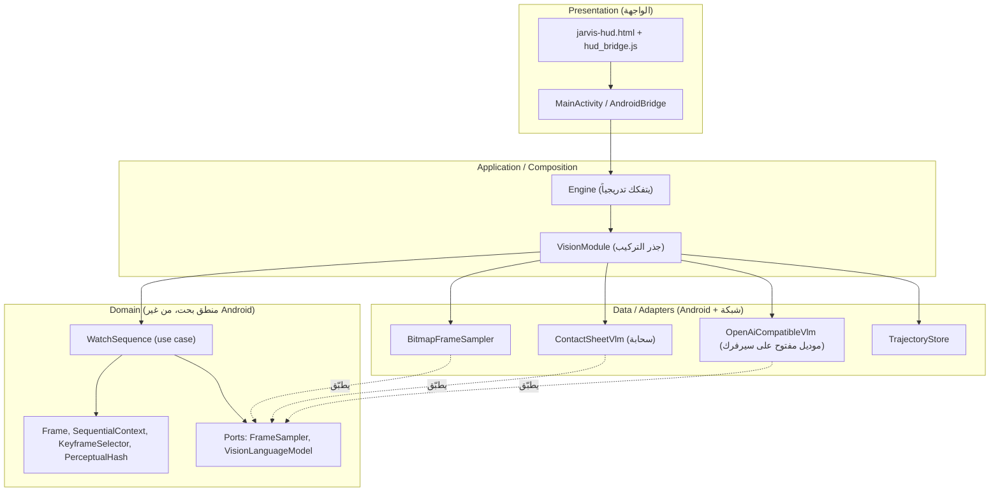
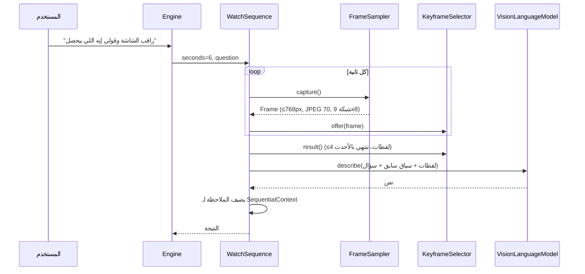
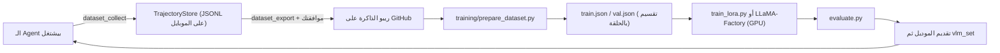

# معمارية JARVIS (Clean Architecture)

هدف الوثيقة: توضيح إزاي اتبنت شريحة الرؤية بمعمارية نظيفة، وإزاي هنحوّل باقي التطبيق لها تدريجياً من غير ما نكسر حاجة.

## 1. الوضع الحالي بصراحة
- `Engine.kt` وحده **3268 سطر وحوالي 155 دالة**: بيجمع الـ Agent، والصوت، والذاكرة، والأوامر، والتقارير. ده "God class": صعب يتختبر ويتغيّر.
- الملفات الأكبر: Engine.kt (3268), JarvisAccessibility.kt (551), Brain.kt (535), MainActivity.kt (204), GitHub.kt (186), CaptureActivity.kt (159).
- القرار: **ما نعيدش كتابته مرة واحدة** (خطر كسر ميزات شغالة من غير ما أقدر أجرّبها على موبايل). بنستخدم نمط **Strangler**: كل ميزة جديدة (وكل جزء بنفككه) تتبني بالطبقات الجديدة، والقديم يتحول لـ "عميل" بيستدعيها.

## 2. الطبقات وقاعدة الاعتماد

**القاعدة:** الأسهم بتروح للداخل بس. `domain` ما بيعرفش حاجة عن Android ولا الشبكة ولا `Engine`. `data` بيعتمد على `domain` بس.
**الإنفاذ:** `ArchitectureTest` بيقرأ الملفات في كل بناء، وبيفشّله لو ظهر `import android.*` أو `org.json` أو `Engine` جوه `domain`، أو `Engine`/`Keys` جوه `data`.

## 3. خط معالجة الصور (سريع وبميزانية)

- **ليه سريع:** كل لقطة بتتصغّر مرة واحدة، وبتتحسب لها بصمة 64-bit (dHash) على شبكة 9×8، والمقارنة XOR + عدّ بتات. اللقطات المتكررة بتتشال **قبل** ما تروح لأي موديل.
- **ميزانية:** أقصى 4 لقطات في الطلب، والسياق السابق محدود (1200 حرف).
- **السياق المتتابع:** `SequentialContext` بيحتفظ بآخر 4 ملاحظات كاملة وبيضغط الأقدم في ملخص قصير، فسؤال زي "وبعدين حصل إيه؟" بيتفهم.
- **اختيار الموديل (Strategy):** لو ضبطت `vlm_set` على سيرفرك → `OpenAiCompatibleVlm` (كل لقطة صورة مستقلة). غير كده → `ContactSheetVlm` (اللقطات في صورة واحدة بتوقيت، فتشتغل مع مزودات السحابة الحالية بدون تغيير).
- **خصوصية:** `VlmEndpointPolicy` بيرفض أي عنوان `http` على إنترنت عام. المسموح: `https`، أو شبكة خاصة (localhost، 192.168.x، 10.x، 172.16-31.x، Tailscale).

## 4. الموديل المفتوح المصدر
| العنصر | البيانات (من GitHub API وبطاقات Hugging Face) |
|---|---|
| موديل خفيف بترخيص مفتوح | **SmolVLM2-2.2B-Instruct**: Apache-2.0، يدعم الفيديو والصور المتعددة |
| موديل أقوى كوكيل شاشة | **Qwen2.5-VL-3B-Instruct**: ترخيص أوزانه `qwen-research` (بحثي) رغم إن كود المشروع Apache-2.0 |
| تقديم الموديل (واجهة OpenAI) | vLLM (Apache-2.0)، Ollama (MIT)، llama.cpp (MIT) |
| التدريب | LLaMA-Factory، TRL، PEFT (كلها Apache-2.0) |
**ترخيص الكود غير ترخيص الأوزان.** بطاقة SmolVLM2 بتقول اللغة English، فالأداء على واجهات عربية لازم يتقاس قبل الاعتماد.

## 5. التدريب على السياق البصري المتتابع

كل عيّنة = آخر ≤3 لقطات + الهدف + الإجراءات السابقة ← الإجراء التالي. بيتعلّم من الخطوات الناجحة بس، والتقسيم بالحلقة كاملة عشان ما يحصلش تسريب بيانات.

## 6. GitHub لإدارة الكود وتحديثه
| الوظيفة | الآلية |
|---|---|
| بناء وتحقق كل push | `build.yml` (بناء + اختبارات Kotlin + معمارية) |
| إصلاح الأعطال | المهندس الآلي ← Pull Request بموافقتك |
| اكتشاف مهارات | صائد المهارات ← Issue ← Pull Request بموافقتك |
| تحديث المكتبات | `dependabot.yml` أسبوعياً ← Pull Requests بتراجعها |
| اختبارات التدريب | `training-tests.yml` |
| بيانات التدريب | `datasets/` في ريبو الذاكرة بعد تأكيدك |
**مفيش دمج تلقائي في أي مسار.**

## 7. مبادئ SOLID (أمثلة فعلية في الكود)
| المبدأ | التطبيق |
|---|---|
| **S** مسؤولية واحدة | `KeyframeSelector` يختار لقطات بس. `SequentialContext` يذكّر بس. `PerceptualHash` يبصم بس |
| **O** مفتوح للإضافة | موديل رؤية جديد = كلاس جديد ينفّذ `VisionLanguageModel` بدون تعديل `WatchSequence` |
| **L** بديل صالح | `ContactSheetVlm` و`OpenAiCompatibleVlm` قابلين للتبديل في أي مكان |
| **I** واجهات صغيرة | `FrameSampler` (دالة واحدة)، `VisionLanguageModel` (دالة واحدة) |
| **D** عكس الاعتماد | الـ use case بيستقبل المنفذين والساعة ودالة الانتظار في الـ constructor، فبيتختبر بساعة وهمية |

## 8. خطة تفكيك `Engine.kt` (خطوة بخطوة)
1. **تم:** الرؤية المتتابعة (`domain/vision`, `data/vision`) + اختيار الموديلات (`Router`, `Usage`, `PromptDiet`, `ModelPick`, `Redact`).
2. `domain/agent`: حلقة الـ Agent (`AgentLoop`) ومنطق كشف التعليق/التكرار كـ use case بمنافذ `ScreenReader` و`ActionPerformer` و`PlannerModel`.
3. `domain/memory`: `Brain` خلف منافذ `MemoryStore` و`EmbeddingProvider`.
4. `domain/voice`: الاستماع والصوت خلف `SpeechRecognizer` و`Speaker`.
5. `Engine` يبقى منسّق رفيع (< 500 سطر) بيوجّه الأوامر لـ use cases.
كل خطوة: PR مستقل + اختبارات + `ArchitectureTest` + تجربة على موبايل قبل الدمج.

## 9. اللي اتنفذ واللي لأ
| البند | الحالة |
|---|---|
| طبقات `domain`/`data` للرؤية + جذر التركيب | منفذ ومتغطّى باختبارات (277 سطر domain، 214 سطر data) |
| إنفاذ قاعدة الاعتماد في CI | منفذ |
| أمر `watch_screen` | منفذ؛ **ما اتجرّبش على موبايل** |
| ربط موديل مفتوح (`vlm_set`) | منفذ؛ **ما اتجرّبش مع سيرفر حقيقي** (الاختبارات بتغطي بناء الطلب وقراءة الرد) |
| تسجيل بيانات التدريب وتصديرها | منفذ؛ ما اتجرّبش على موبايل |
| سكربتات التجهيز والتقييم | منفذة ومختبرة (14 اختبار) |
| **تدريب موديل فعلي** | **لسه**: محتاج GPU وبيانات حقيقية |
| تفكيك باقي `Engine` | لسه (الخطوات 2-5) |
